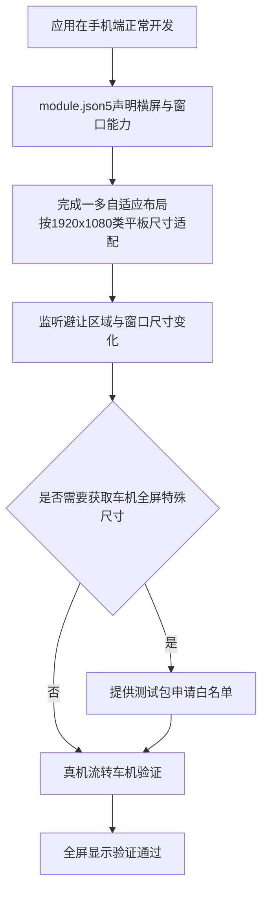

# 超级桌面流转应用全屏显示适配指南


> 适用场景：手机应用通过超级桌面流转至鸿蒙智行车机后无法全屏显示的问题排查与适配
> 参考设备组合：Mate 60 Pro + 问界 M9（鸿蒙智行）
> 
> ---
> 

## 一、问题现象

手机应用通过超级桌面流转到车机后，部分应用无法全屏显示：


- 上方区域显示车机状态栏
- 下方区域保留空调、座椅调节等车辆控制区
- 应用实际显示区域被压缩在中间


而抖音、微信、红果等系统应用和第三方应用可正常全屏显示。


## 二、根因分析

超级桌面将手机应用流转到车机时，会依据应用的适配状态选择不同的渲染路径：

| 应用状态 | 渲染路径 | 显示效果 |
| --- | --- | --- |
| 已完成横屏与自适应布局适配 | 全屏自适应路径 | 正常全屏显示 |
| 未完成适配 | 平行视界式安全容器 | 避让上下系统区域，显示区域被压缩 |

华为官方 FAQ 明确说明：部分应用无法全屏显示，是因为第三方应用没有适配超级桌面平行视界模式。


## 三、核心问题解答


### 1. 应用是否需要针对超级桌面或车机端进行特殊适配？

**需要适配**。超级桌面是华为提供手机应用在鸿蒙智行车机上运行的解决方案，应用需接入 Car Kit 出行互联类接口，根据超级桌面连接状态获取车机屏幕信息用于 UI 呈现。核心适配点包括：


- 在 module.json5 中声明横屏能力与窗口尺寸范围，否则系统会将其判定为“手机比例应用”，不分配横屏全屏分辨率
- 完成“一次开发，多端部署”自适应布局——应用完成一多能力适配后，通过超级桌面流转到车机屏幕，无需重新适配即可兼容车机屏幕显示
- 监听避让区域与窗口尺寸变化：手机侧存在避让区域而车机侧没有，且迁移后窗口尺寸、DPI 会发生变化，需根据最新参数动态调整布局


### 2. 是否有相关的开发文档、接口说明或适配规范可以参考？

有，详见文末“参考文档”章节。同时需注意：**车机全屏特殊尺寸需要申请白名单**。


- 默认情况下，应用从超级桌面拉起时获取到的是手机窗口尺寸（如 2760×1256），而非车机全屏的 1920×1080
- 需要获取该特殊尺寸用于适配时，须开通白名单权限，流程为：提供测试包 → 内部测试 → 申请加入白名单
- 官方同时说明：只要在开发过程中对 1920×1080 类平板尺寸做好适配，实际车机全屏场景下基本不会出现问题


### 3. 上下区域无法显示，是应用自身问题还是显示策略问题？

**两者兼有，但根因在应用侧**。超级桌面/车机端确实对不同应用有不同的显示策略，但该策略是依据应用适配状态动态选择的：适配完善的应用被允许全屏运行，未适配的应用被放入安全容器避让系统区域。因此正确的解决路径是完成应用侧适配，而非调整车机端设置。


## 四、整体适配流程




## 五、示例代码

### 5.1 module.json5 配置

声明横屏能力、窗口尺寸范围与所需权限（字段详细约束以官方 module.json5 配置说明为准）：

```json5
{
  "module": {
    "abilities": [
      {
        "name": "EntryAbility",
        // 声明支持横屏，避免被系统判定为竖屏手机比例应用
        "orientation": "auto_rotation",
        // 声明支持的窗口模式
        "supportWindowMode": ["fullscreen"],
        // 声明合理的窗口尺寸范围，覆盖车机大屏场景
        "minWindowWidth": 800,
        "minWindowHeight": 450,
        "maxWindowWidth": 3840,
        "maxWindowHeight": 2160
      }
    ],
    "requestPermissions": [
      {
        // Car Kit 出行互联能力所需权限
        "name": "ohos.permission.ACCESS_CAR_DISTRIBUTED_ENGINE"
      }
    ]
  }
}
```

### 5.2 Ability 中开启沉浸式布局并监听状态变化

```typescript
// EntryAbility.ets
import { UIAbility } from '@kit.AbilityKit';
import { window } from '@kit.ArkUI';
import { smartMobilityCommon } from '@kit.CarKit';
import { hilog } from '@kit.PerformanceAnalysisKit';
import { BusinessError } from '@kit.BasicServicesKit';

const DOMAIN: number = 0x0000;
const TAG: string = 'SuperLauncherDemo';

export default class EntryAbility extends UIAbility {
  private awareness: smartMobilityCommon.SmartMobilityAwareness | null = null;

  onWindowStageCreate(windowStage: window.WindowStage): void {
    windowStage.getMainWindow().then((win: window.Window) => {
      // 1. 开启沉浸式布局：布局区域延伸至整个窗口
      win.setWindowLayoutFullScreen(true).catch((err: BusinessError) => {
        hilog.error(DOMAIN, TAG, `setWindowLayoutFullScreen failed, code: ${err.code}`);
      });
      // 2. 监听避让区域变化：手机与车机之间流转时避让区会变化
      win.on('avoidAreaChange', (data: window.AvoidAreaOptions) => {
        hilog.info(DOMAIN, TAG,
          `avoidArea type: ${JSON.stringify(data.type)}, area: ${JSON.stringify(data.area)}`);
        // 根据最新避让区宽高，对页面安全区域做动态避让
      });
      // 3. 监听窗口尺寸变化：流转后分辨率、DPI 可能变化，按最新尺寸重新布局
      win.on('windowSizeChange', (size: Array<window.Size>) => {
        hilog.info(DOMAIN, TAG, `windowSize: ${JSON.stringify(size)}`);
        // 根据最新窗口尺寸切换布局（如断点、横竖屏布局）
      });
    }).catch((err: BusinessError) => {
      hilog.error(DOMAIN, TAG, `getMainWindow failed, code: ${err.code}`);
    });
    this.listenSuperLauncherStatus();
  }

  // 监听超级桌面连接状态，感知应用是否已流转到车机
  private listenSuperLauncherStatus(): void {
    try {
      this.awareness = smartMobilityCommon.getSmartMobilityAwareness();
      // SUPER_LAUNCHER 即超级桌面业务类型
      const types: smartMobilityCommon.SmartMobilityType[] =
        [smartMobilityCommon.SmartMobilityType.SUPER_LAUNCHER];
      const callback = (info: smartMobilityCommon.SmartMobilityInfo): void => {
        if (info.status === smartMobilityCommon.SmartMobilityStatus.RUNNING) {
          // 应用已通过超级桌面在车机运行，可在此切换车机大屏布局
          hilog.info(DOMAIN, TAG, 'app is running on super launcher');
        }
      };
      this.awareness.on('smartMobilityStatus', types, callback);
    } catch (e) {
      const err = e as BusinessError;
      hilog.error(DOMAIN, TAG, `on smartMobilityStatus error, code: ${err.code}`);
    }
  }

  onDestroy(): void {
    // 退出时取消监听，避免内存泄漏
    try {
      if (this.awareness !== null) {
        const types: smartMobilityCommon.SmartMobilityType[] =
          [smartMobilityCommon.SmartMobilityType.SUPER_LAUNCHER];
        this.awareness.off('smartMobilityStatus', types);
      }
    } catch (e) {
      const err = e as BusinessError;
      hilog.error(DOMAIN, TAG, `off smartMobilityStatus error, code: ${err.code}`);
    }
  }
}
```

## 六、参考文档

| 文档 | 链接 |
| --- | --- |
| Car Kit 连接状态指南（超级桌面场景适用） | https://developer.huawei.com/consumer/cn/doc/harmonyos-guides/car-check-application-start |
| Car Kit 监听连接状态 | https://developer.huawei.com/consumer/cn/doc/harmonyos-guides/car-listener-connect-status |
| smartMobilityCommon API 参考 | https://developer.huawei.com/consumer/cn/doc/harmonyOS-references/car-smartmobilitycommon |
| 一次开发多端部署最佳实践 | https://developer.huawei.com/consumer/cn/doc/best-practices/bpta-multi-device-overview |
| 开发者论坛同类案例（含白名单申请路径） | https://developer.huawei.com/consumer/cn/forum/topic/0203214147777505169 |

另可参考窗口管理文档（@ohos.window），涵盖沉浸式布局与避让区域处理。

## 七、注意事项

- Car Kit 系统能力为 SystemCapability.CarService.DistributedEngine，仅支持手机设备（6.1.0(23) 版本起支持平板），仅中国大陆地区可用
- 模拟器完全不支持，必须使用手机与鸿蒙智行车机真机联调验证
- 调用出行互联接口必须申请 ohos.permission.ACCESS_CAR_DISTRIBUTED_ENGINE 权限，无权限调用会返回 201 错误码
- 可先通过 canIUse 判断设备是否支持该系统能力，不支持时跳过车载相关逻辑
- 白名单申请需通过华为开发者联盟渠道提交工单，提供测试包并完成内部测试后加入
- 页面中有标题栏等不希望与避让区重叠的内容时，可对组件设置 expandSafeArea 属性实现沉浸式效果，也可直接通过 setWindowLayoutFullScreen 实现全屏沉浸式

## 八、验证要点

Mate 60 Pro 与问界 M9 组合完全满足真机联调条件，建议按上述流程完成适配后，重点验证：

1. 流转瞬间 avoidAreaChange 回调中的布局刷新是否正常
2. 流转瞬间 windowSizeChange 回调中的布局刷新是否正常
3. 应用在车机端是否获得全屏分辨率并正常铺满屏幕
```
